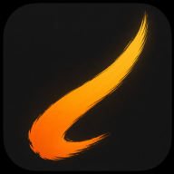

<p align="center"></p>

<h1 align="center">Qelem — native edition</h1>

Qelem's experimental native painting and animation app, based on [ProCraft](https://github.com/artcraft-android/procraft)'s Kotlin/Jetpack Compose interface and Rust/wgpu engine. This is **work in progress**, not a finished replacement for the existing Qelem app.

## Download

[Download the Qelem native preview APK (arm64)](../artifacts/Qelem-native-preview-arm64.apk) · Android 9 or later · [build and signature details](../artifacts/Qelem-native-preview-arm64.txt)

This debug-signed development APK was built on GitHub, but **has not been tested on an Android device**. It is a separate app and not an update to existing Qelem. The existing [Qelem 7.23 development APK](../artifacts/Qelem-7.23-dev.apk) is the older WebView-based app, not this native edition.

## What's being built

- Qelem name, logo and amber accent in the native Android interface.
- ProCraft's painting engine, layers, brushes and animation assist as the starting point.
- Temporary animation preview reverse, frame range, and 50%/100%/200% speed. These affect preview only, not saved animation or exports.
- Storyboard PNG, transparent sprite-sheet PNG, and palette chart PNG sharing. The sheets render visible top-level frames once, not repeated holds; see [details and limits](QELEM-FUSION.md).

These additions have focused JVM tests, and the arm64 APK compiles; graphics, touch, device performance and export sharing have **not** been verified on a device. Many Qelem features still need porting. The existing Qelem project format is not compatible and no migration/importer exists.

## Windows and phone tablet

An experimental Windows build can pair with a separate Android blank-pad controller over a trusted LAN. [Setup, security and limitations](QELEM-PHONE-TABLET.md). This is not a system-wide Wacom driver.

## Keep your artwork safe

Back up projects in the existing Qelem app and verify the backups. **Do not uninstall Qelem.** The native preview has a separate application ID, so it will not see existing private artwork or update the existing app. No lossless conversion is available yet.

## Building

The Android build requires JDK 17+, Rust (workspace minimum 1.95), Android SDK API 36 (the preview uses Compose BOM 2026.03.00), NDK `29.0.14206865`, cargo-ndk 4, Rust Android targets and Gradle's dependency downloads. From this directory:

```sh
cd android
./gradlew :app:assembleDebug -Pprocraft.abis=arm64-v8a
```

Debug APK: `android/app/build/outputs/apk/debug/app-debug.apk`. This is a development build with a separate package and debug signing; it is not a production update. See [QELEM-FUSION.md](QELEM-FUSION.md) for scope, tests and limitations.

## Credits and licensing

The native base is a fork of [ProCraft](https://github.com/artcraft-android/procraft) at commit `c330afd009eae7c739af1a4d61293b1e4b4d3dca`, licensed [MIT](LICENSE-MIT) OR [Apache-2.0](LICENSE-APACHE). Third-party notices and asset credits are retained in [NOTICE](NOTICE) and [ATTRIBUTION.md](ATTRIBUTION.md). Qelem is not affiliated with ProCraft or Procreate.
